  <a href="https://mark-app.com">
    <picture>
      <source media="(prefers-color-scheme: dark)" srcset="assets/header-dark.svg">
      
    </picture>
  </a>

We build, fix and grow PrestaShop webshops. From a quick bug fix to a full upgrade from 1.6 to 9, from a custom module to technical SEO: one team, short lines and real people on the phone.

<picture>
  <source media="(prefers-color-scheme: dark)" srcset="assets/stats-dark.svg">
  
</picture>

### What we do

<picture>
  <source media="(prefers-color-scheme: dark)" srcset="assets/services-dark.svg">
  
</picture>

<picture>
  <source media="(prefers-color-scheme: dark)" srcset="assets/upgrade-path-dark.svg">
  
</picture>

### How we build modules

- Compatible from PrestaShop 8 up to 9, tested in real shops before every release
- Validated on [validator.prestashop.com](https://validator.prestashop.com) before we ship
- Hooks instead of core overrides, so your shop stays upgradable
- Clean, multilingual and multistore ready

  

  <a href="https://mark-app.com/en/">mark-app.com</a> &nbsp;·&nbsp;
  <a href="https://mark-app.com/nl/contact-opnemen">Contact (NL)</a> &nbsp;·&nbsp;
  <a href="https://mark-app.com/en/contact-us">Contact (EN)</a> &nbsp;·&nbsp;
  <a href="mailto:info@mark-app.com">info@mark-app.com</a>

